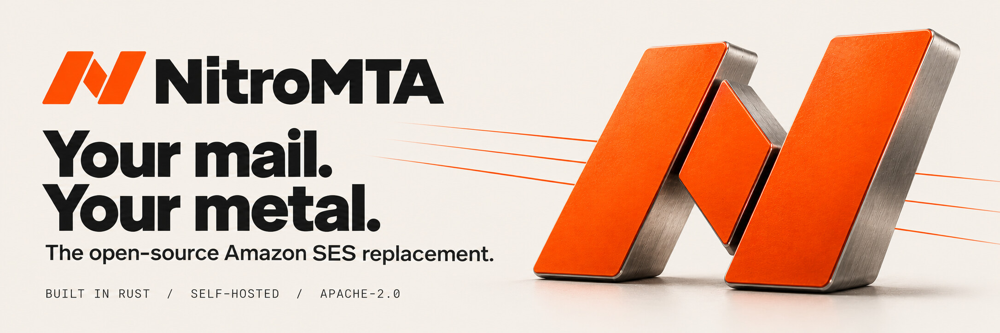

# NitroMTA

<picture>
  <source media="(prefers-color-scheme: dark)" srcset="docs/assets/brand/hero-dark.jpg">
  <source media="(prefers-color-scheme: light)" srcset="docs/assets/brand/hero-light.jpg">
  
</picture>

**The open-source Amazon SES replacement. Built in Rust.**

[Nitrosend](https://nitrosend.com)'s mail delivery engine, open sourced.

[Try locally](#try-it) · [Run it on your servers](#run-it-on-your-own-servers) · [Compatibility](docs/compatibility.md)

A self-hosted mail delivery engine that speaks the Amazon SES v2 API. Point
an application built for SES, or any SMTP client, at it by changing the
endpoint and credentials, and it delivers your mail directly from IP
addresses you control.

- **SES v2 compatible:** `SendEmail`, `SendBulkEmail`, email templates,
  identities, configuration sets, tenants, the suppression list, dedicated
  IPs and SES-shaped events through an SNS subset. See
  [compatibility](docs/compatibility.md).
- **Durable:** a submission is answered only once it is committed to disk,
  and survives a crash, a power cut, and the loss of its host when its disk
  survives. See [durability](docs/durability.md).
- **Deliverability built in:** a new IP warms up receiver by receiver from
  50 messages a day, rising after clean days and backing off when
  complaints, bounces or throttling climb. Each provider gets its own
  connection limits and cooldowns, hard bounces and spam complaints
  suppress the address, and mail is DKIM-signed and sent over TLS,
  verified by MTA-STS and DANE where published.
- **One binary:** a Rust engine with its store in SQLite, a systemd unit,
  and a CLI that explains why any message is waiting.

<picture>
  <source media="(prefers-color-scheme: dark)" srcset="docs/assets/brand/delivery-path-dark.svg">
  <source media="(prefers-color-scheme: light)" srcset="docs/assets/brand/delivery-path-light.svg">
  
</picture>

## Try it

Capture mode runs the whole engine on your machine and shows each message
in a browser instead of sending it, with no DNS or IP address needed:

```sh
nitromta setup --config config.toml --capture
nitromta run --config config.toml
```

Give it an account and an access key, then send with the SES SDK you
already use:

```python
import boto3

# Your SES code as it is, pointed at the engine: only the endpoint and the keys change.
ses = boto3.client("sesv2", endpoint_url="https://127.0.0.1:4443", region_name="us-east-1")
sent = ses.send_email(
    FromEmailAddress="app@example.test",
    Destination={"ToAddresses": ["someone@example.com"]},
    Content={"Simple": {"Subject": {"Data": "from the quickstart"}, "Body": {"Text": {"Data": "hello"}}}},
)
print(sent["MessageId"])
```

Open `http://127.0.0.1:9090/capture` to see the message as its receiver
would have been given it. The [capture quickstart](docs/capture.md) has
every step, the account and key among them, and SMTP too.

## Run it on your own servers

What any sending host needs: outbound port 25, which many cloud providers
block until asked; a reverse DNS name for each sending IP; and a domain
whose DNS you control. [Choosing a host](docs/hosting.md) says which
providers open port 25 and how.

Release archives for x86_64 and arm64 Linux, with signed build provenance,
are on the [releases page](https://github.com/nitrosend/nitromta/releases),
and a container image is `ghcr.io/nitrosend/nitromta`.
[Installation](docs/install.md) takes a host from the archive to its first
delivered message in six steps, ending with `nitromta doctor`, which checks
reverse DNS, SPF, DKIM, DMARC and the bounce MX, and tells you what to
publish.

Followed step by step on a fresh server, those steps delivered every
message they sent, to Gmail, Outlook, Yahoo, AOL, iCloud and Office 365
mailboxes among others, signed and passing DKIM, SPF and DMARC.

## Documentation

Guides:

- [Capture quickstart](docs/capture.md): the whole engine on your machine,
  no DNS or IP needed
- [Installation](docs/install.md): a server to its first delivered message
- [Choosing a host](docs/hosting.md): port 25, reverse DNS and the
  providers that allow them

Reference:

- [Operations](docs/operations.md): explaining a message, the queue,
  metrics, holds, warmup and keys
- [Compatibility](docs/compatibility.md): the SES operations, SMTP, events,
  and where the engine differs from SES
- [Durability](docs/durability.md): what an acceptance promises, and the
  limits
- [Changelog](CHANGELOG.md)

## Building

```sh
cargo build --release
cargo xtask check
```

`cargo xtask check` is the one gate, and CI runs the same command.
[CONTRIBUTING.md](CONTRIBUTING.md#the-gate) says what it checks and what it
needs.

## Contributing and security

See [CONTRIBUTING.md](CONTRIBUTING.md). Report a vulnerability privately, as
[SECURITY.md](SECURITY.md) says.

## License

Apache-2.0, by [Nitrosend](https://nitrosend.com) and
[auscaster](https://auscaster.com).
