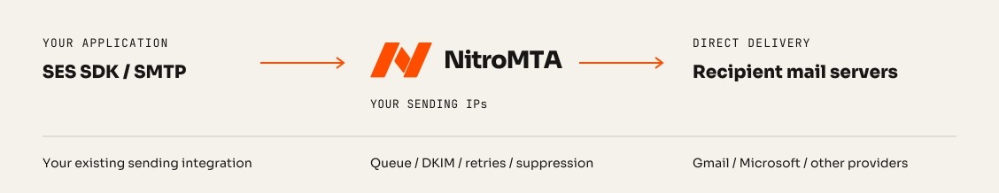

<div align="center">


<h3>The open-source Amazon SES replacement.</h3>

[Nitrosend](https://nitrosend.com)'s mail delivery engine, open sourced and built in Rust.<br>
Keep your SES code, change the endpoint, and deliver from IP addresses you control.

[](https://github.com/nitrosend/nitromta/actions/workflows/check.yml)
[](https://github.com/nitrosend/nitromta/releases/latest)
[](LICENSE)

[Try it](#try-it) · [Run it on your servers](#run-it-on-your-own-servers) · [Benchmarks](#benchmarks) · [Compatibility](docs/compatibility.md) · [nitromta.com](https://nitromta.com)

</div>

<br>

- **SES v2 compatible:** `SendEmail`, `SendBulkEmail`, email templates,
  identities, configuration sets, tenants, the suppression list, dedicated
  IPs and SES-shaped events through an SNS subset, tested with the official
  SDKs. See [compatibility](docs/compatibility.md).
- **Durable:** a submission is answered only once it is committed to disk,
  and survives a crash, a power cut, and the loss of its host when its disk
  survives. See [durability](docs/durability.md).
- **Fast:** 3,313 messages a second on 4 CPUs, each committed to disk
  before it is accepted: 3.16 times KumoMTA and 4.11 times Postfix on the
  same machine. See [benchmarks](#benchmarks).
- **Deliverability built in:** a new IP warms up receiver by receiver from
  50 messages a day, rising after clean days and backing off when
  complaints, bounces or throttling climb. Each provider gets its own
  connection limits and cooldowns, hard bounces and spam complaints
  suppress the address, and mail is DKIM-signed and sent over TLS,
  verified by MTA-STS and DANE where published.
- **One binary:** a Rust engine with its store in SQLite, a systemd unit,
  and a CLI that explains why any message is waiting.



## Try it

Capture mode runs the whole engine on your machine and shows each message
in a browser instead of sending it, with no DNS or IP address needed:

```sh
nitromta setup --config config.toml --capture
nitromta run --config config.toml
```

Give it an account and an access key, then send with the SES SDK you
already use:

```python
import boto3

# Your SES code as it is, pointed at the engine: only the endpoint and the keys change.
ses = boto3.client("sesv2", endpoint_url="https://127.0.0.1:4443", region_name="us-east-1")
sent = ses.send_email(
    FromEmailAddress="app@example.test",
    Destination={"ToAddresses": ["someone@example.com"]},
    Content={"Simple": {"Subject": {"Data": "from the quickstart"}, "Body": {"Text": {"Data": "hello"}}}},
)
print(sent["MessageId"])
```

Open `http://127.0.0.1:9090/capture` to see the message as its receiver
would have been given it. The [capture quickstart](docs/capture.md) has
every step, the account and key among them, and SMTP too.

## Run it on your own servers

What any sending host needs: outbound port 25, which many cloud providers
block until asked; a reverse DNS name for each sending IP; and a domain
whose DNS you control. [Choosing a host](docs/hosting.md) says which
providers open port 25 and how.

| Where | How |
|---|---|
| Debian, Ubuntu | the `.deb` from the [latest release](https://github.com/nitrosend/nitromta/releases/latest), `sudo apt install ./nitromta_<version>_amd64.deb` |
| RHEL, Fedora | the `.rpm` from the latest release, `sudo dnf install ./nitromta-<version>-1.x86_64.rpm` |
| Arch | `nitromta-bin` from the AUR |
| Docker | `ghcr.io/nitrosend/nitromta` |
| macOS or Linux, to try it | `brew install nitrosend/tap/nitromta` |
| Any Linux | the x86_64 and arm64 archives on the releases page |

Every archive and package carries build provenance signed by GitHub.
[Installation](docs/install.md) takes a host to its first delivered message
in six steps, ending with `nitromta doctor`, which checks reverse DNS, SPF,
DKIM, DMARC and the bounce MX, and tells you what to publish. Moving an application from SES is
[a change of endpoint and keys](docs/migrate-from-ses.md).

Followed step by step on a fresh server, those steps delivered every
message they sent, to Gmail, Outlook, Yahoo, AOL, iCloud and Office 365
mailboxes among others, signed and passing DKIM, SPF and DMARC.

## Documentation

The same pages are at [nitromta.com/docs](https://nitromta.com/docs/).

Guides:

- [Capture quickstart](docs/capture.md): the whole engine on your machine,
  no DNS or IP needed
- [Installation](docs/install.md): a server to its first delivered message
- [Choosing a host](docs/hosting.md): port 25, reverse DNS and the
  providers that allow them
- [Migrating from SES](docs/migrate-from-ses.md): endpoint, keys,
  identities and events
- [Benchmarks](docs/benchmarks.md): the comparison, how it is measured, and
  its raw results

Reference:

- [Operations](docs/operations.md): explaining a message, the queue,
  metrics, holds, warmup and keys
- [Compatibility](docs/compatibility.md): the SES operations, SMTP, events,
  and where the engine differs from SES
- [Durability](docs/durability.md): what an acceptance promises, and the
  limits
- [Command line](docs/reference/cli.md): every command and its options
- [Configuration](docs/reference/configuration.md): what `nitromta setup`
  writes, every setting explained
- [Changelog](CHANGELOG.md)

## Benchmarks

Each system on 4 CPUs of an AWS c7gd.metal server, its queue on local NVMe,
committing every message to disk before accepting it: 16 KiB messages,
DKIM-signed, TLS in and out. The highest rate each sustained, median of
three runs: 1.35 million messages across the nine, every one delivered once
and DKIM-verified.

| | Messages a second | CPU per message |
|---|--:|--:|
| **NitroMTA** | **3,313** | 1.169 ms |
| KumoMTA 2026.09.29 | 1,048 | 2.492 ms |
| Postfix 3.11.7 with OpenDKIM | 806 | 4.969 ms |

To run it yourself, on any machine with rustup and Docker:

```sh
cargo harness quick
```

[Benchmarks](docs/benchmarks.md) has the method and every run.

## Building

```sh
cargo build --release
cargo xtask check
```

`cargo xtask check` is the one gate, and CI runs the same command.
[CONTRIBUTING.md](CONTRIBUTING.md#the-gate) says what it checks and what it
needs.

## Contributing and security

See [CONTRIBUTING.md](CONTRIBUTING.md). Report a vulnerability privately, as
[SECURITY.md](SECURITY.md) says.

## License

Apache-2.0, by [Nitrosend](https://nitrosend.com) and
[Kam](https://auscaster.com).
